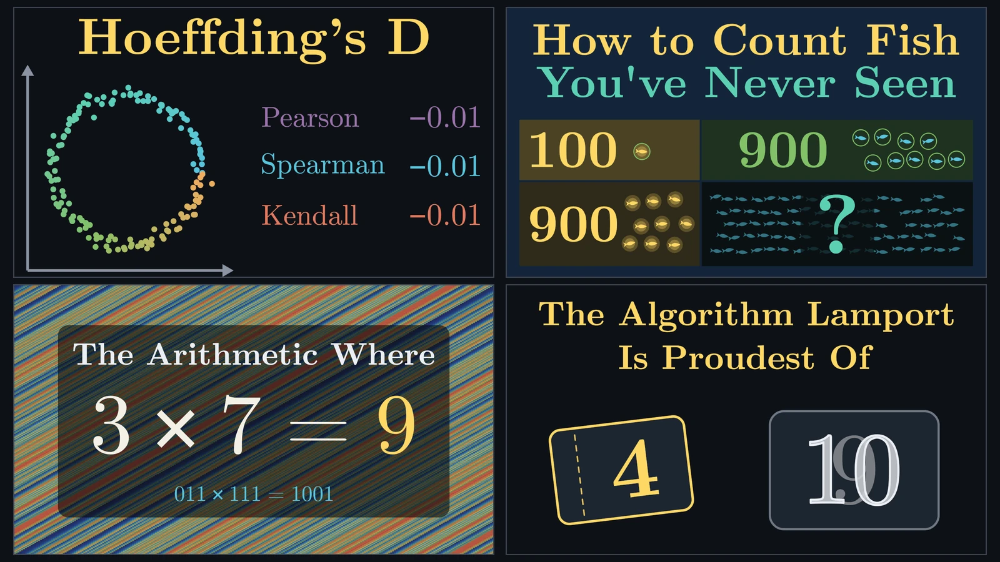
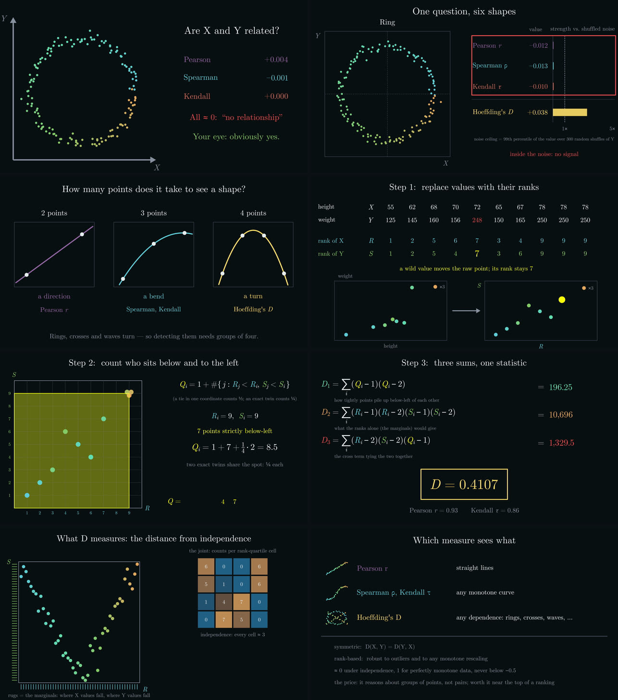

# jeffs_math_explainer_videos

<div align="center">



<br/>

[](./LICENSE)
[](https://doc.rust-lang.org/edition-guide/rust-2024/)
[](https://github.com/Dicklesworthstone/franken_manim)
[](https://github.com/Dicklesworthstone/franken_tts)
[](https://github.com/Dicklesworthstone/franken_manim)
[](./docs/planning/COMPREHENSIVE_PLAN_FOR_JEFFS_MATH_EXPLAINER_VIDEOS.md)

**A monorepo of narrated, 3Blue1Brown-style 4K math explainer videos, each one written in Rust against [franken_manim](https://github.com/Dicklesworthstone/franken_manim) (native TeX, no LaTeX, no Python) and voiced by [FrankenTTS](https://github.com/Dicklesworthstone/franken_tts). Every number on screen or in the narration is computed by the scene and pinned against an independent oracle, every narration line is checked by speech recognition and never time-stretched, every frame is looked at before it ships, and a warm, procedurally synthesized score sits under the voice without competing with it.**

</div>

> **A note on tense.** Like franken_manim's README, this one describes the
> *method* in the present tense, because the method is fixed and every video
> follows it. What exists today is stated separately and plainly: see
> [The corpus](#the-corpus) and [Status](#status). All four videos now have a
> 4K60 master in the `michael` voice that passes the strict verify, and all
> four are published on YouTube (the links are in [The corpus](#the-corpus)).
> Seven more, videos 5 to 11, follow: the Fair Coin (5), Mental Math Tricks (6) and the
> matrix exponential (10) are published too, and the other four have verified 4K60 masters, not yet published.

---

## TL;DR

**The goal.** Explain genuinely deep mathematics so clearly that a curious
14-year-old follows it, a working programmer could implement it afterwards,
and a professional mathematician finds nothing incorrect or misleading and
marvels at the clarity. Never by dumbing down: by finding the right picture,
the right tiny example, the right order, and by earning every formula.

**The problem with the usual way.** Explainer videos are usually assembled from
tools that cannot check themselves. Numbers are typed into slides, so they drift
from the math. Narration is recorded once and stretched to fit the picture, so
it sounds smeared. Background music is chosen by taste and mixed by ear, so it
masks the consonants that carry the meaning. And the rendering stack (manim +
LaTeX + Python + system fonts) is a multi-gigabyte install that renders
differently on every machine.

**The approach here.** Each video is a Rust program:

| | How it works here |
|---|---|
| Picture | Scenes written against franken_manim's native `fmn` facade: native TeX typesetting, an analytic Bézier rasterizer with the 3b1b look, 3D surfaces with a moving camera, flowing streamlines, live readouts recomputed from moving objects every frame. One binary; ffmpeg is the only external tool. |
| Numbers | Computed by the scene from the same data it draws, then pinned at startup against an independent oracle (`oracle.py`). A typed number is a defect. Every "always" or "never" in the script is tested at its edges before it is voiced. |
| Voice | FrankenTTS, one call per sentence, several takes, each transcribed by FrankenWhisper and scored; the best take wins. Every name is looked up and its pronunciation verified against a control and a decoy. Only cuts and gain touch the audio: never time-stretch, pitch-shift or loudnorm. |
| Timing | The picture waits for the voice: scenes are written as beats keyed to script lines, so re-recording a line re-times the animation. |
| Sound | A std-only Rust synthesizer (band-limited drifting oscillators, ladder filters, chorus, tape colour, modal mallets, FM electric piano, plucked strings, an FDN reverb), ducked under the voice with perfect look-ahead and a spectral pocket, with harmony that moves and melody only in the gaps. Automated checks enforce level, masking and monotony budgets. |
| Review | Every frame is looked at (layout lint, contact sheets, cue sheets). Each video is reviewed three times through three named viewers and a mathematician's audit, and the findings and their dispositions are committed. |
| Delivery | 3840×2160 at 60 fps, explicit encoder quality, one fixed mastering gain to −16 LUFS (quieter when the −1.5 dBTP ceiling binds, as it does for the `michael` voice), a strict verify, captions from the exact cue timings. Renders never enter git; finished cuts ship as GitHub Release assets. |

---

## The corpus

| # | Video | What it explains | Status |
|---|---|---|---|
| 1 | [**Hoeffding's D**](explainer_corpus/hoeffding_d/) | Why Pearson, Spearman and Kendall all read ≈ 0 on a ring of points, and how Hoeffding's D sees any dependence: ranks, quadruples, the bivariate count Q, the formula earned term by term, and a live permutation test. | **Finished** (v5: 8:27, 4K60, narration ASR QA 0.999). Imported from its [original repository](https://github.com/Dicklesworthstone/franken_manim_hoeffding_explainer); runs here on the shared kit and passes 20/20 tests (its 7 encoder tests moved into the kit); `hoeffding stats` prints exactly what v5 printed. Its v6, re-scored by the new engine (QA 8 of 8 chapters) and mastered from PCM at 4K60, is rendered. The owner then chose the `michael` voice for all four videos: the release cut is that variant (9:04, 8 chapters, music QA 8 of 8, −17.8 LUFS at the −1.5 dBTP ceiling, strict verify passes, captions). **Published:** [youtu.be/C9xOzbLIARg](https://youtu.be/C9xOzbLIARg). |
| 2 | **How to Count Fish You've Never Seen** | Capture–recapture from Feller's *Introduction to Probability Theory*, Vol. I: two catches form a four-cell table with one dark cell nobody caught; the hypergeometric distribution shows the best fill for that cell is the one that balances the table, which is the proportion guess; then honest uncertainty, simulation, failure modes, and the same table counting France, hidden bugs and the dead in Kosovo. | **4K60 master done** in the `michael` voice (18:12, 15 chapters, music QA 15 of 15, −18.1 LUFS at the −1.5 dBTP ceiling, strict verify passes, captions). **Published:** [youtu.be/KNxRE255i-o](https://youtu.be/KNxRE255i-o). `matt`'s original cut (ASR QA 0.989) is kept. |
| 3 | **The Arithmetic Where 3 × 7 = 9** | The finite-field mathematics behind RaptorQ fountain codes: packets as XOR equations, why exactly enough random ones fail 71% of the time and why that risk lives at the end, why wrapping around at 256 fails just as badly, bytes as polynomials folded by x⁸+x⁴+x³+x²+1, the 255-hour byte clock, and how RaptorQ spends 10–16 byte-field rows exactly where the danger lives. | **4K60 master done** in the `michael` voice (21:04, 17 chapters, music QA 17 of 17, −18.0 LUFS at the −1.5 dBTP ceiling, strict verify passes, captions). **Published:** [youtu.be/uWDPs9JIwEk](https://youtu.be/uWDPs9JIwEk). `leo`'s cut (21:14, −16.0 LUFS) is kept as a comparison. |
| 4 | **The Algorithm Lamport Is Proudest Of** | Lamport's bakery algorithm: lost updates as staircases through a progress square, tickets without a ticket machine, the two cracks and their fixes, a proof a mathematician will respect, why it survives memory that returns garbage, fairness and its price, and why your CPU still needs fences. | **4K60 master done** (15:43, voice `michael`, ASR QA 0.997, 13 chapters, music QA 13 of 13, −17.6 LUFS at the −1.5 dBTP ceiling, strict verify passes, captions); the lock measured on Arm and x86 for chapter 12. **Published:** [youtu.be/eXU6NC2fuCw](https://youtu.be/eXU6NC2fuCw). |
| 5 | [**How to Make a Fair Coin Out of an Unfair One**](explainer_corpus/fair_coin/) | Toss an unfair coin twice and throw matching pairs away: heads-then-tails against tails-then-heads is exactly fair whatever the coin's chance of heads, and nobody has to know that chance. Why, what it costs, how it breaks, and how the same idea makes a fair die out of a loaded one. | **4K60 master done** in the `michael` voice (11:56, 11 chapters, −17.7 LUFS at the −1.5 dBTP ceiling, strict verify passes, captions). **Published:** [youtu.be/f6iskjcSQCQ](https://youtu.be/f6iskjcSQCQ). |
| 6 | [**Mental Math Tricks That Actually Work (and Why)**](explainer_corpus/mental_math/) | Squares ending in five, products by parts as a running total, two numbers equally far from a middle, squares near fifty (the trick Hans Bethe showed Richard Feynman), percents, halving and doubling, round then fix: each with the rectangle that makes it true, and "your turn" quizzes with a countdown. | **4K60 master done** in the `michael` voice (15:34, 14 chapters, music QA 14 of 14, −18.1 LUFS at the −1.5 dBTP ceiling, strict verify passes, captions). **Published:** [youtu.be/wahnqlfOC84](https://youtu.be/wahnqlfOC84). |
| 7 | [**Why Robot Arms Think in Lie Groups**](explainer_corpus/lie_robotics/) | Turns that refuse to add and the one move that makes them add (do the arithmetic on the flat piece, then wrap it back on), screws, a seven-joint arm as a product of exponentials, the Jacobian, the directions an arm can lose, its spare joint, and Newton's method on the group of poses. | **4K60 master done** in the `michael` voice (16:38, 15 chapters, −17.8 LUFS at the −1.5 dBTP ceiling, strict verify passes, captions). **Published:** [youtu.be/G9P5aDGMAGU](https://youtu.be/G9P5aDGMAGU). |
| 8 | [**How to Find a Lost Submarine**](explainer_corpus/bayesian_search/) | Bayesian search by counting dots: a map of where the thing could be, a rule for where to look next, and the update that turns "we found nothing" into new knowledge, then the same move at Palomares, on the USS *Scorpion*, for Air France 447 and in a Coast Guard rescue. | **4K60 master done** in the `michael` voice (15:54, 14 chapters, −18.1 LUFS at the −1.5 dBTP ceiling, strict verify passes, captions). **Published:** [youtu.be/JY88xN-0Jjw](https://youtu.be/JY88xN-0Jjw). |
| 9 | [**Proofs You Can See**](explainer_corpus/visual_proofs/) | Eight proofs you can see and one picture that lies: odd numbers as layers, two staircases, the sum of cubes, Siu's three stacks, halves and quarters, the cut cube, four triangles and the missing square, each asking whether the next size would fit. | **4K60 master done** in the `michael` voice (18:11, 15 chapters, −17.9 LUFS at the −1.5 dBTP ceiling, strict verify passes, captions). **Published:** [youtu.be/MCPzPBy_bhM](https://youtu.be/MCPzPBy_bhM). |
| 10 | [**What Does It Mean to Raise e to a Matrix?**](explainer_corpus/matrix_exponential/) | The exponential turns a rule for tiny steps into where you end up: a number in the exponent gives growth, `i` gives turning, and a matrix gives the motion of a whole linked system, down to how computers actually compute it. | **4K60 master done** in the `michael` voice (18:09, 16 chapters, −18.0 LUFS at the −1.5 dBTP ceiling, strict verify passes, captions). **Published:** [youtu.be/KHcukYSw53E](https://youtu.be/KHcukYSw53E). |
| 11 | [**The One Idea Behind Bridges, Concert Halls and Economies**](explainer_corpus/eigen_engineering/) | The patterns a system hands back unchanged except for size: described in them, a tangle of equations falls apart into one-line problems, for how a steel truss sags and sways, which notes a room sings back and whether an economy can feed itself, and where the idea stops. | **4K60 master done** in the `michael` voice (15:02, 14 chapters, −18.1 LUFS at the −1.5 dBTP ceiling, strict verify passes, captions); not yet published. |



---

## How a video is made

```text
 brief ─► facts + oracle ─► storyboard ─► review R1 ─► script ─► review R2 + audit
   │                                                              │
   │   (every number computed, then pinned)    (one beat per line; prediction pauses;
   │                                             one word per idea; listen windows)
   ▼                                                              ▼
 build: scenes in Rust ─► 540p drafts + layout lint + contact/cue sheets (read every one)
                                                                  │
 narration: FrankenTTS per sentence ─► FrankenWhisper scores ─► best take ─► ASR gate
                                                                  │
 narrated draft ─► score: timeline pass ─► music stems ─► score QA ─► review R3
                                                                  │
 4K60 chapters in parallel ─► PCM master (one fixed gain) ─► strict verify ─► release
```

Each arrow is a gate that fails closed; the `./x` driver runs each step
(recording the gates for `./x status`, so an agent can resume by asking what
is next, is still to come).
The full pipeline, with every gate, is §4 of the
[plan](docs/planning/COMPREHENSIVE_PLAN_FOR_JEFFS_MATH_EXPLAINER_VIDEOS.md).

## Design commitments

| Commitment | One-line statement |
|---|---|
| **Correctness first** | Every number is computed and oracle-checked; every simplification keeps its exact version on screen or in the description; every always/never is tested at its edges. |
| **The voice leads** | The picture waits for the narration; the music holds still under speech and plays out in the gaps; narration is never stretched. |
| **Show, then name** | A situation before an abstraction, the idea before its name, numbers before letters, a formula only after it is earned. |
| **Three viewers, every time** | A 14-year-old, a programmer and a mathematician review each video three times; a chapter one of them cannot summarize in a sentence is rewritten. |
| **Spectacle that carries ideas** | The engine's most advanced features (3D camera moves, flowing fields, thousands of particles, live recomputation) appear only where they make an idea visible. Decoration is a defect. |
| **Look at every frame** | Layout lint, contact sheets and cue sheets are read before anything is called done. |
| **Honest status** | Measured numbers carry their sample sizes; model numbers say "model"; nothing is announced until it passes its gate. |

## The sound

The first video's score was a static sine-wave pad per chapter plus bell chimes.
Measured against the real narration, the pad's chord tones sat inside the
narrator's pitch range, its detuned sines pumped with a 12 dB beating tremolo,
and, as actually mixed, it sat only about 5.6 LU under the voice; the chimes
put their energy at 2.4–4.8 kHz, exactly where consonants live, and cost up to
0.165 of speech intelligibility at each onset. The new engine
([`crates/explainer_score`](crates/explainer_score/), std-only Rust, built to
§7 of the plan and
[`docs/research/sound_design/`](docs/research/sound_design/)) fixes that by
construction:

- warm, analog-style voices (PolyBLEP oscillators with slow random pitch drift,
  zero-delay-feedback ladder filters, Juno- and Solina-style chorus, tape wow and
  flutter, modal marimba/vibraphone/kalimba, FM electric piano, Karplus–Strong
  plucks, an 8-line FDN reverb);
- the bed 18 LU under the voice during speech and 10 LU under it in authored
  gaps, ducked offline with perfect look-ahead from the known narration
  timeline, with a 1–4 kHz pocket carved while the voice speaks;
- no sustained music inside the narrator's pitch band during speech (measured
  per voice from the real takes), no melody starting
  under a sentence, chords moving every 4–16 seconds, and a musical identity per
  video (key, palette, a leitmotif in scale degrees);
- sonification only where it teaches, in authored listen windows: in the bakery
  video only one process's melody can ever sound at a time, so mutual exclusion
  is audible and a violation sounds like a bug.

Measured on the Hoeffding narration by the plan's §7.6 QA, the v5 score and the
new one, chapter by chapter (8 chapters, the same voice placement and QA code
for both):

| Metric (limit) | v5 pad + chimes | New engine |
|---|---|---|
| voice − music, median of 3 s windows over speech (≥ 16 LU; plan target 18) | 7.4–9.2 LU, 8 fail | 17.7–18.5 LU |
| music's loudest 400 ms during speech, re the speech's (≤ −15 LU) | −1.7 to 0.0 LU, 8 fail | −22.5 to −18.6 LU |
| speech-intelligibility (SII-lite) loss, worst 400 ms (≤ 0.03) | 0.07–0.25, 8 fail | ≤ 0.001 |
| music/voice energy at 1–4 kHz during speech (≤ −20 dB) | −20.4 to −10.6 dB, 7 fail | −38.0 to −32.9 dB |
| clicks (0) | up to 2 per chapter, 7 fail | 0 |
| exposed beating, steady stretches (≤ 6 dB) | not measurable (no score facts) | 1.1–2.2 dB |
| chapters passing every gate | 0 of 8 | 8 of 8 |

The A/B itself (the v5 4K video with each soundtrack, loudness-matched) is for
the owner's ears; metrics can rule a score out, not in.

## Repository layout

```text
crates/
  explainer_score/       the sound engine: DSP, instruments, theory, arrangement,
                         offline duck and pocket, listen-window sonifications,
                         §7.6 QA (std-only Rust)
  explainer_kit/         the shared scene kit: palette, text and math helpers, live
                         readouts, playback, plots, narration and the exact cue
                         log, layout lint, NumPy-parity stats, facts harness,
                         delivery encoder, the shared CLI with the two-pass score,
                         the PCM master, captions and thumbnails
explainer_corpus/        one directory per video (each a Rust crate)
  hoeffding_d/           corpus entry 1 (finished; imported, now on the shared kit)
  capture_recapture/     How to Count Fish You've Never Seen (binary `fish`)
  raptorq_gf256/         The Arithmetic Where 3 × 7 = 9 (binary `gf256`)
  bakery_algorithm/      The Algorithm Lamport Is Proudest Of (binary `bakery`)
  fair_coin/             How to Make a Fair Coin Out of an Unfair One (binary `coin`)
  mental_math/           Mental Math Tricks That Actually Work (and Why) (binary `mental`)
  lie_robotics/          Why Robot Arms Think in Lie Groups (binary `lie`)
  bayesian_search/       How to Find a Lost Submarine (binary `search`)
  visual_proofs/         Proofs You Can See (binary `proofs`)
  matrix_exponential/    What Does It Mean to Raise e to a Matrix? (binary `expm`)
  eigen_engineering/     The One Idea Behind Bridges, Concert Halls and Economies (binary `eigen`)
tools/                   storyboard → script.tsv, facts-check against the oracle,
                         persona review packets, the private-details scan
x                        the driver: build, test, draft, narrated, score, final,
                         master, captions, verify, watch, thumbnail
.github/workflows/       CI: the private-details scan, the storyboard check, and
                         the score engine's tests on every push
docs/
  planning/              the comprehensive plan (architecture, doctrine, all storyboards)
  research/              one memo per topic plus scripts that recompute every number
  reviews/plan_r1/       review round 1 of the plan: three viewers, an audit,
                         engine feasibility, creative direction, and their scripts
.beads/                  the work graph (br): what to build next, and in what order
AGENTS.md                rules for coding agents working here
LICENSE                  MIT with an OpenAI/Anthropic rider
```

Still to come, per the plan's §3: `templates/explainer/` (`./x new`) and the
driver's gate tracking (`./x status`).

## Building

Every video builds the same way. The workspace pins franken_manim by git
revision, so nothing else needs to be checked out:

```bash
git clone https://github.com/Dicklesworthstone/jeffs_math_explainer_videos
cd jeffs_math_explainer_videos
cargo test --release -p hoeffding_explainer   # rustup fetches the pinned nightly; first build fetches the FrankenSuite (~6.5 GB cargo home)
cargo build --release -p hoeffding_explainer
target/release/hoeffding stats  # every number the video shows
target/release/hoeffding render 01_hook --res 960x540 --fps 30 --silent --out draft
```

The newer videos run through the driver, which wraps the same binaries
(`fish`, `gf256`, `bakery`; each also has `facts`, `script`, `chapters`):

```bash
./x raptorq_gf256 test          # tests, clippy -D warnings, fmt --check
./x raptorq_gf256 facts-check   # every number against oracle.py
./x raptorq_gf256 draft         # 960x540 scratch-voice drafts + layout lint; ./x … sheets
./x raptorq_gf256 narrated      # with the real narration + the cue check and cue sheets
./x raptorq_gf256 score         # the music: timeline pass, then stems with QA
./x raptorq_gf256 final         # 3840x2160@60 chapters; then master, captions, verify
./x raptorq_gf256 watch scored  # one file of the scored draft, to watch
```

- `render` needs `ffmpeg` on `PATH`; `stats`, `script` and `cargo test` don't.
- A narrated render needs the voice-over WAVs, which are generated, not
  committed (see the explainer's README).
- Producing narration uses the owner's FrankenTTS narration skills, referenced
  by path rather than vendored here.

The sound engine and its A/B on the Hoeffding narration (the demo reads the
explainer's timeline pass, run with the v5 narration WAVs; see the example's
header):

```bash
cargo test --release -p explainer_score
HOEFFDING_V5_SOUND=1 target/release/hoeffding render --timeline-only --narration NARRATION_DIR --out RENDER_DIR
cargo run --release -p explainer_score --example score_demo -- RENDER_DIR OUT_DIR
```

The research scripts run with a plain Python 3 (`python3 -I <script>.py`); a few
need numpy or the `raptorq` package, as each folder's `scripts/README.md` says.

## Status

| Piece | State |
|---|---|
| Hoeffding's D explainer | finished (v5); v6 rendered: the new score (QA 8 of 8), the PCM master at 4K60 (strict verify passes); v5 vs v6 excerpts await the owner's listening verdict |
| Research for videos 2–4 | done: memos plus verification scripts (exact arithmetic, an RFC 6330 implementation byte-identical to an independent one, an exhaustive model checker for the bakery algorithm), plus the bakery lock measured on Arm and x86 |
| The plan | revision 2: architecture, doctrines and beat-by-beat storyboards, revised after a five-reviewer round |
| Shared workspace | built: root Cargo workspace, franken_manim pinned by git revision |
| Score engine (`explainer_score`) | built and tested; the Hoeffding A/B passes its QA in 8 of 8 chapters (v5: 0 of 8) and awaits the owner's listening verdict |
| Scene kit (`explainer_kit`) | built and tested: the shared CLI (two-pass score), the PCM master, captions, thumbnails, and shared props (code panels, proportion bars, row-strip tables) |
| Corpus driver (`./x`) | runs every step from drafts to the verified master; gate tracking (`./x status`) and the template (`./x new`) are still to come |
| CI | every push: the private-details scan, the storyboard check, and the score engine's fmt, clippy and tests |
| Videos 2–4 | see [The corpus](#the-corpus): all three mastered at 4K60 in the `michael` voice and published on YouTube, as is Hoeffding's D |
| Videos 5–11 | see [The corpus](#the-corpus): each has its oracle-pinned facts, a description whose every number is checked against them, a thumbnail scene and a YouTube package; the Fair Coin (5), Mental Math Tricks (6) and the matrix exponential (10) are published, and the other four have verified 4K60 masters, not yet published |

## Limitations

- **Narration needs the FrankenTTS skills.** The narration pipeline (takes,
  scoring, pronunciation probes, the release gate) lives in the owner's
  published skills and is referenced by path. Without them you can build and
  render the pictures, but not regenerate the voice.
- **Heavy work wants a big machine.** TTS, speech recognition and 4K finals run
  best on a many-core host (video B's 4K final, 75,359 frames with x264 at CRF
  16, took 40 minutes on 36 cores); a laptop can draft at 540p.
- **The engine has honest gaps** (from the plan's engine review): no 2D camera
  pan or zoom on the fast route, no bloom, a few Greek letters drawn in variant
  forms, 3D only on a slower CPU route. The videos work around each one, and
  §14 of the plan lists them for upstream.
- **Renders are not in git.** At 200–300 MB, a 4K master is over GitHub's
  100 MB file limit; finished cuts are published as release assets.

## FAQ

**Why Rust and franken_manim instead of manim?** One binary, native TeX with no
LaTeX install, deterministic output, and live readouts recomputed from the
picture every frame. A real-world measurement: the Hoeffding explainer's binary
is 9.2 MB; making the same kind of video with legacy manim means installing a
LaTeX distribution and a Python stack of 0.9–11 GB.

**Why so much process for a video?** Because the failure modes are real and
were all hit: a number on screen that drifted from the math, a narration
stretched until it smeared, an "always" that was false with ties, a chime that
buried a consonant at the moment of a reveal. Each gate exists because of one of
those.

**Are the videos AI-generated?** The narration voice is synthetic (FrankenTTS),
and AI agents write much of the code and the first drafts under the owner's
direction. The mathematics is checked by code, not by trust: every number
against an oracle, every claim in a fact sheet with its source, every quote
verbatim.

**Can I use the research?** The memos and scripts in `docs/research/` are part
of this repository and carry its license.

## About Contributions

Please don't take this the wrong way, but I do not accept outside contributions for any of my projects. I simply don't have the mental bandwidth to review anything, and it's my name on the thing, so I'm responsible for any problems it causes; thus, the risk-reward is highly asymmetric from my perspective. I'd also have to worry about other "stakeholders," which seems unwise for tools I mostly make for myself for free. Feel free to submit issues, and even PRs if you want to illustrate a proposed fix, but know I won't merge them directly. Instead, I'll have Claude or Codex review submissions via `gh` and independently decide whether and how to address them. Bug reports in particular are welcome. Sorry if this offends, but I want to avoid wasted time and hurt feelings. I understand this isn't in sync with the prevailing open-source ethos that seeks community contributions, but it's the only way I can move at this velocity and keep my sanity.

## License

The source code, research memos and scripts in this repository are licensed
under the **MIT License with an OpenAI/Anthropic Rider**, Copyright (c) 2026
Jeffrey Emanuel (see [`LICENSE`](./LICENSE)). The rider withholds all rights
from OpenAI, Anthropic, their affiliates, and anyone acting on their behalf,
including any use of the software or derivative works in a machine-learning
dataset, training corpus, evaluation harness, or pipeline. In any conflict
between the rider and the rest of the license, the rider controls. Short
quotations from published works in the research memos are attributed to their
sources.

## See also

- [`COMPREHENSIVE_PLAN_FOR_JEFFS_MATH_EXPLAINER_VIDEOS.md`](docs/planning/COMPREHENSIVE_PLAN_FOR_JEFFS_MATH_EXPLAINER_VIDEOS.md): the plan (revision 2): mission and the three viewers, the engine's verified capabilities, the repository architecture, the production pipeline and its gates, the pedagogy, visual and sound doctrines, beat-by-beat storyboards for every new video, testing, workstreams, risks and decisions.
- [`AGENTS.md`](./AGENTS.md): rules for agents working in this repository.
- [franken_manim](https://github.com/Dicklesworthstone/franken_manim): the animation engine.
- [FrankenTTS](https://github.com/Dicklesworthstone/franken_tts) and [FrankenWhisper](https://github.com/Dicklesworthstone/franken_whisper): the voice and the ears.
